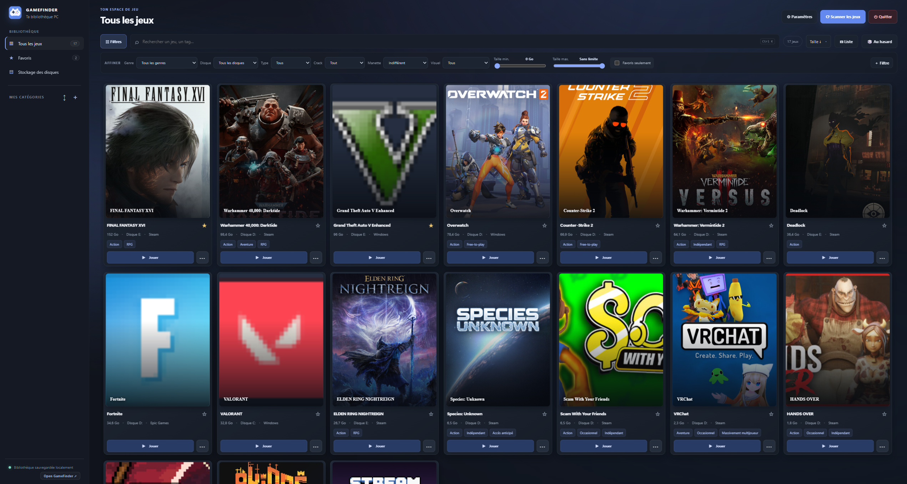
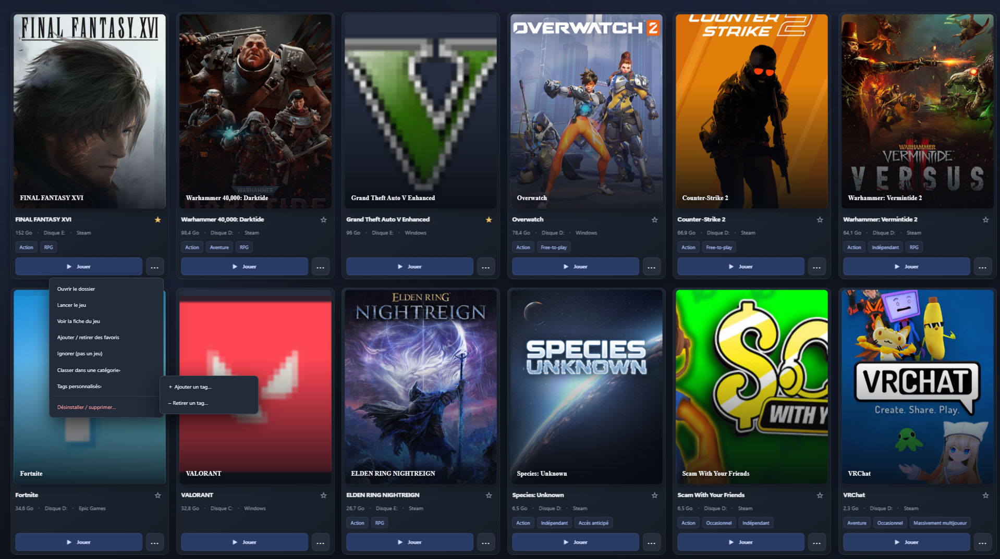
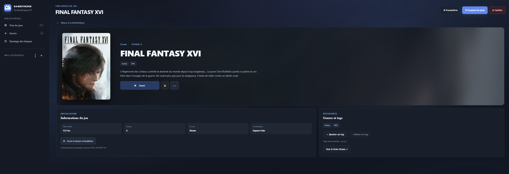
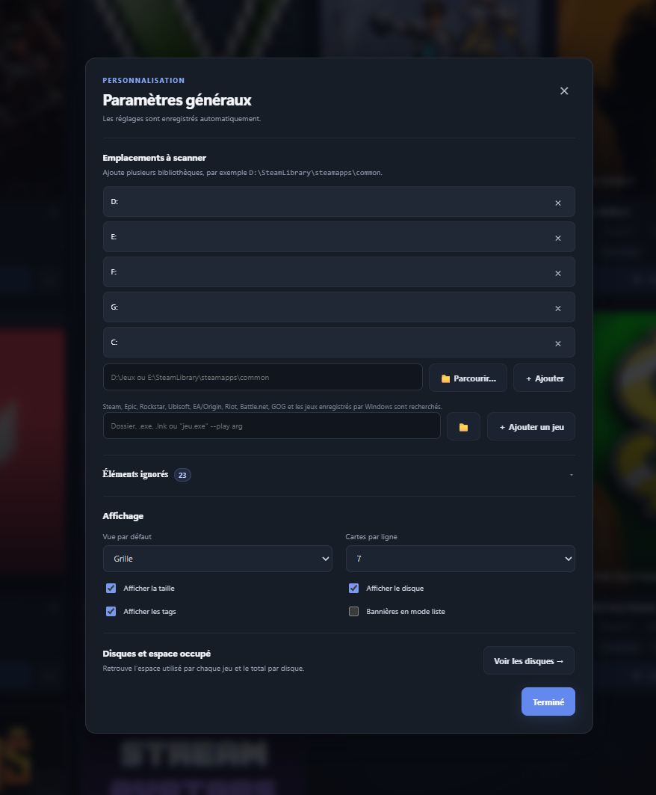
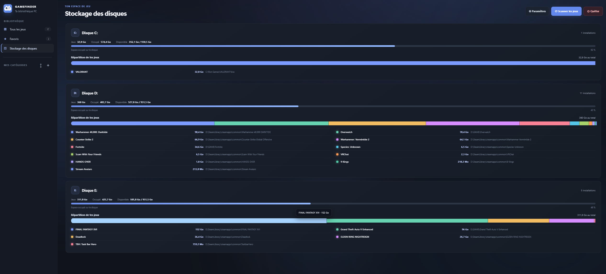
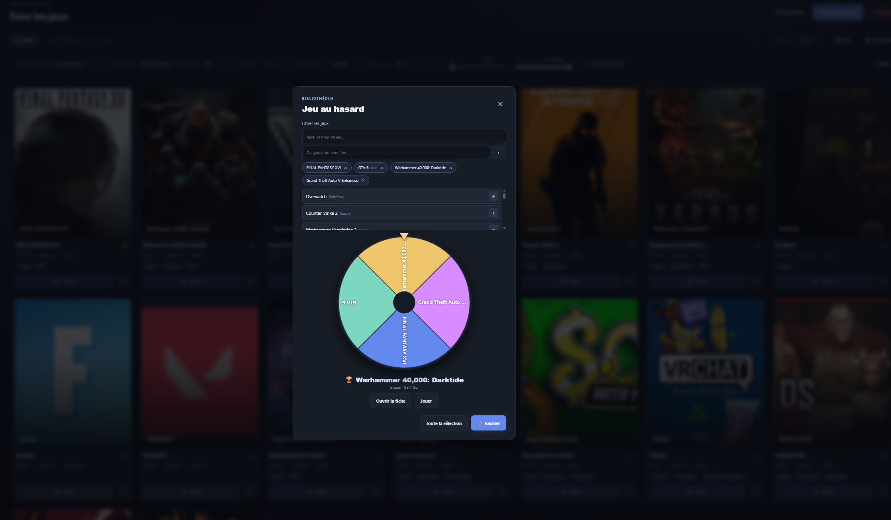

# 🎮 GameFinder

**Ta bibliothèque de jeux PC, réinventée.**

GameFinder scanne ton ordinateur, retrouve tous tes jeux installés — Steam, Epic, GOG, Ubisoft, EA, Riot, Battle.net, Xbox… ou simples dossiers — et les présente dans une magnifique interface web locale : jaquettes, tags, collections, favoris et statistiques de stockage disque.


## ✨ Fonctionnalités

- **Scan automatique** des manifestes Steam (`appmanifest_*.acf`, `libraryfolders.vdf`) et Epic, des entrées du registre Windows (désinstalleurs) et des exécutables dans tes dossiers personnalisés
- **Ajout manuel** : dossier, `.exe`, `.bat`, raccourci `.lnk` ou ligne de commande complète (`"jeu.exe" --play arg`)
- **Métadonnées Steam** : jaquettes HD, genres, tags communautaires (SteamDB), descriptions, support manette — avec cache local
- **Icônes d'exécutables** extraites directement de Windows (Win32/ctypes, sans dépendance)
- **Collections** : catégories personnalisées (glisser-déposer pour réordonner), tags manuels, favoris, filtres enregistrés
- **Filtres avancés** : recherche, genre, disque, taille min/max, manette, source, image
- **Tri bidirectionnel** : Nom A→Z / Z→A, Taille croissante / décroissante
- **Page Stockage** : occupation de chaque disque, espace libre, répartition des jeux par disque avec barres segmentées
- **Actions** : lancer, ouvrir le dossier, fiche du jeu, classer, taguer, désinstaller ou ignorer les faux positifs
- **Roulette au hasard** : choisir des jeux à la main ou filtrer, puis lancer une roue animée pour le verdict
- **Effet Liquid** réactif à la souris en arrière-plan (Three.js, avec fallback 2D hors-ligne)
- **Ouverture dans Firefox** en un clic, icône dans la zone de notification
- **100 % local** : serveur `127.0.0.1` avec token d'authentification, données dans `%APPDATA%\GameFinder`
- **7 langues** : Français, English, Español, Deutsch, Italiano, 日本語, 中文 — sélection dans Paramètres → Affichage

## 📸 Captures d'écran








## 🚀 Installation

Prérequis : **Python 3.10+** et **Pillow**

```powershell
git clone https://github.com/CptnMathh/GameFinder.git
cd GameFinder
python -m pip install -r requirements.txt
python main.py
```

Au premier lancement, `D:\SteamLibrary\steamapps\common` est ajouté automatiquement s'il existe. Les autres emplacements s'ajoutent dans **⚙ Paramètres**.

## 📦 Build exécutable Windows

```powershell
.\build.ps1
```

Génère `dist\GameFinder.exe` (PyInstaller, onefile, sans console). Si l'exe est verrouillé par Windows, le script produit `GameFinder-Updated.exe` à la place.

## 🛠️ Stack technique

| Couche | Technologie |
|---|---|
| Backend | Python 3 stdlib (`http.server`, `winreg`, `ctypes`) — zéro framework |
| Frontend | HTML/CSS/JS vanilla dans `web/`, pas de build step |
| Effet Liquid | [`threejs-components`](https://github.com/kevinlevron/threejs-components) `liquid1` (CDN jsdelivr, fallback canvas 2D) |
| Packaging | PyInstaller (`--onefile --windowed`) |
| Données | JSON atomiques dans `%APPDATA%\GameFinder` |

## 🗂️ Structure

```
main.py      Serveur HTTP local, API REST, actions Windows (lancement, tray, dialogs)
scanner.py   Détection des jeux, métadonnées Steam/SteamDB, icônes, cache
web/         Interface (index.html, styles.css, app.js, liquid.webp)
build.ps1    Script de build PyInstaller
```

## 🔒 Vie privée

Tout reste sur ta machine : le serveur n'écoute que `127.0.0.1`, chaque session a un token aléatoire, et les seules requêtes sortantes sont les APIs publiques Steam/SteamDB pour les jaquettes et tags.

## ⚠️ Limites connues

- Les permissions Windows peuvent empêcher le calcul de certaines tailles de dossiers
- Les métadonnées et jaquettes dépendent de la disponibilité des pages Steam/SteamDB
- Le scraping SteamDB peut casser si leur HTML change
- L'effet Liquid nécessite internet (CDN) ; le fallback 2D prend le relais hors-ligne
- **Licence** : l'effet Liquid (`threejs-components`) est sous **CC BY-NC-SA 4.0** — usage non commercial avec attribution (Kevin Levron)

## 📄 Licence

Projet personnel — MIT (à adapter selon tes souhaits).
